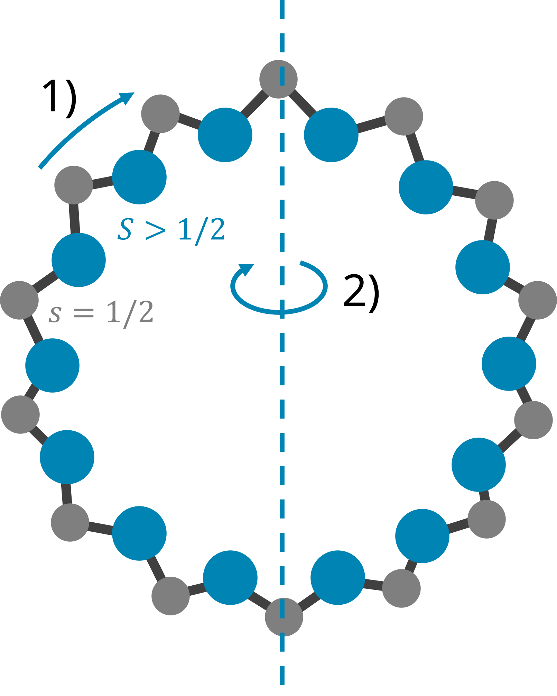
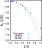

# Performance Study: Magnetization Plateau in a Mixed-Spin Chain

This page describes a calculation workflow using **site-dependent spin magnitudes** and **magnetization-sector constraints** through

- `list_spin.dat`
- `list_NODmax.dat`

The figure below is an archived study illustration. The repository does not
currently provide its complete per-point input decks, raw energy table,
source commit, compiler settings, or analysis script; the plotted study has
therefore not been certified as reproducible from this page alone.

The archived illustration concerns the **spin-dependence of the magnetization plateau width** in a one-dimensional mixed-spin chain consisting of alternating spins

$$
(S,1/2).
$$

The plateau occurs at

$$
\frac{M}{M_s}=\frac{2S-1}{2S+1}.
$$

---

# Model Hamiltonian

We consider an antiferromagnetic mixed-spin chain described by

$$
\hat H =
J\sum_{j=1}^{L}
\left[
\hat{\mathbf s}_{2j}\cdot
(\hat{\mathbf S}_{2j-1}+\hat{\mathbf S}_{2j+1})
-
h(\hat S^z_{2j-1}+\hat s^z_{2j})
\right],
$$

with periodic boundary conditions

$$
\hat{\mathbf S}_{2L+1}=\hat{\mathbf S}_1.
$$

Here

- $\hat{\mathbf S}_{2j-1}$ : spin-$S$ operator
- $\hat{\mathbf s}_{2j}$ : spin-$1/2$ operator

The coupling constant satisfies

$$
J>0
$$

and we set

$$
J=1
$$

as the unit of energy.

The system contains $2L$ sites corresponding to $L$ unit cells.

{ width="450" }

---

# Symmetry

The Hamiltonian is invariant under

- two-site translation
- site inversion

The ground state appears in the symmetry sector

- momentum $k=0$
- even inversion parity

corresponding to

```
M1 = 0
M2 = 0
```

in the ED2 input file.

---

# Saturation magnetization

The saturation magnetization is

$$
M_s = \sum_{r=1}^{2L} S_r
$$

For the alternating chain

$$
(S,1/2)
$$

this becomes

$$
M_s = L(S+1/2) = \frac{L(2S+1)}{2}.
$$

---

# Magnetization sector

We denote the number of lowering operations from the fully polarized state by

$$
N_{\downarrow}.
$$

To select one conserved magnetization sector in QS³-ED2, set **both**
`NODmin` and `NODmax` to this integer. Setting only `NODmax` generally
retains several sectors.

At the plateau position

$$
\frac{M}{M_s}=\frac{2S-1}{2S+1},
$$

the lowering number is

$$
N_{\downarrow}=L.
$$

Its upper boundary involves comparing the sectors

$$
N_{\downarrow}=L
$$

and

$$
N_{\downarrow}=L-1.
$$

---

# QS³‑ED2 Input Configuration

The following is schematic: replace `2L`, `L`, and the selected lowering
number by actual integer values before putting them in a Fortran NAMELIST.
For a system with $2L$ sites

```
NOS    = 2L
L1     = L
L2     = 2
NO_one = 0
NO_two = 2L
NODmin = n
NODmax = n
```

Here `NO_one=0` computes the zero-field energy $E_0(n)$. To include a
physical Zeeman term $-hS^z$, use input field coefficients `hz=-h`,
because ED2 adds the supplied coefficients as $+\mathbf h_{\rm input}\cdot\mathbf S$.

The symmetry sector is specified as

```
M1 = 0
M2 = 0
```

The local spins and lowering limits are defined using

```
list_spin.dat
list_NODmax.dat
```

while the symmetry permutations are specified using

```
list_p1.dat
list_p2.dat
```

---

# Table 1: Structure of the Input Files

The following table summarizes the structure of the input files used in the mixed-spin chain example.

| list_spin.dat | list_NODmax.dat | list_p1.dat | list_p2.dat |
|---|---|---|---|
| S   | min[2S, NODmax] | 3 | 1 |
| 0.5 | 1               | 4 | 2L |
| S   | min[2S, NODmax] | 5 | 2L − 1 |
| 0.5 | 1               | 6 | 2L − 2 |
| S   | min[2S, NODmax] | 7 | 2L − 3 |
| 0.5 | 1               | 8 | 2L − 4 |
| …   | …               | … | … |
| S   | min[2S, NODmax] | 1 | 3 |
| 0.5 | 1               | 2 | 2 |

### Column descriptions

**`list_spin.dat`**  
Specifies the local spin magnitude at each lattice site.

**`list_NODmax.dat`**  
Defines the maximum number of lowering operations allowed at each site.  
For a spin‑$S$ site the maximum possible number of lowering operations is $2S$, therefore the constraint is written as

```
min[2S, NODmax]
```

to ensure consistency with the physical Hilbert space.

**`list_p1.dat`, `list_p2.dat`**  
Define the two-site translation and site-centered inversion permutations,
respectively. They are one-column site maps, not interaction pairs. The
Hamiltonian bonds and their coefficients belong in `list_xyz_dm_gamma.dat`
(the path assigned to `FILE_xyz_dm_gamma`).

---

# Determining the Plateau Width

In a magnetic field $h$, the ground state minimizes

$$
E_0(N_{\downarrow}) - hM(N_{\downarrow}).
$$

The critical field between neighboring magnetization sectors is

$$
h_c(N_{\downarrow}) =
E_0(N_{\downarrow}-1)-E_0(N_{\downarrow}).
$$

This is the **upper** field boundary of the sector with lowering number
$n=N_{\downarrow}$, obtained by equating the two field-dependent energies.
The lower neighboring boundary is $E_0(n)-E_0(n+1)$, so the plateau width is

$$
\Delta h=E_0(n-1)+E_0(n+1)-2E_0(n).
$$

A single energy difference gives the width only when the lower boundary is
separately known to be zero. Compare all competing sectors when a
non-neighboring crossing is possible.

---

# Finite‑Size Behaviour

The archived illustration considered

$$
L = 2,3,\dots,8.
$$

The raw size-dependent energies are not archived with this page, so its
finite-size error cannot be independently assessed here. Recompute and
report the size dependence for the chosen spin values and tolerance.

---

# Benchmark Result

{ width="450" }

The original figure was presented as a comparison with DMRG and nonlinear
spin-wave calculations. The corresponding bibliographic references,
comparison data, and numerical error estimates need to be supplied before
claiming independently verified agreement.

---

# Summary

This workflow uses

- heterogeneous local spins
- flexible magnetization-sector constraints
- symmetry-reduced Hilbert spaces

To turn the archived figure into a reproducible study, publish the
generated model and symmetry files, the energies in each magnetization
sector, the source revision, execution metadata, and the plotting script.
