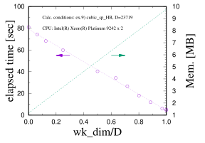

# Performance: dependence of runtime on `wk_dim`

`wk_dim` controls the **number of representative-state Hamiltonian rows
cached**, rather than the number of individual matrix elements. A negative
value requests all rows in the selected space; zero requests on-demand
construction; a positive value caches up to that many rows. See
[Hamiltonian caching, performance, and memory](../user-guide/performance-and-memory.md)
for the current implementation and optional CSR controls.

## Model used in the archived figure

The historical experiment uses the isotropic antiferromagnetic Heisenberg
model from [Example 9](../examples/cubic_sp_HB.md):

$$
H=\sum_{\langle r,r'\rangle}\mathbf S_r\cdot\mathbf S_{r'}
$$

on a periodic $10\times10\times10$ lattice of spin-$1/2$ sites. The
calculation fixes three down spins, zero momentum, and even reflection
parities. Thus $S^z=1000/2-3=497$. The unreduced fixed-magnetization
space has

$$
\binom{1000}{3}=166{,}167{,}000
$$

states, and the selected symmetry representation has $D=23{,}719$ states.
These are dimensions of the specified few-magnon sector, not of the full
$2^{1000}$ product space. The archived timing study disabled local
magnetization and correlation output.

## Transition capacity and memory

Three well-separated magnons each have six possible hops, giving at most
18 off-diagonal hopping records, plus a diagonal record. `MNTE` is an
allocation capacity: padded arrays allocate `MNTE+1` slots per cached row.
The shipped input uses the conservative value `MNTE=19`; the printed
`Optimal MNTE = 19` diagnostic counts occupied records **including** the
diagonal. It does not mean that `MNTE` controls the Lanczos-vector count.

For the current LP64 implementation, the main padded coefficient/location
arrays use approximately

$$
(16+4)\,\mathrm{wk\_dim}\,(\mathrm{MNTE}+1)\ \text{bytes},
$$

plus row counts and other program allocations. This array payload is not
peak process RSS. Changing to CSR, retaining or releasing padded arrays,
and using direct two-pass construction changes which allocations coexist.
Record the complete cache configuration for any comparison.

## What caching avoids

Without caching, a Hamiltonian action regenerates transition coefficients
and maps destination configurations into the selected representative-state
basis. Cached rows reuse those results. The cost of a cached action scales
with the occupied records traversed, while uncached rows also incur row
construction and symmetry lookup. Construction cost, row occupancy,
symmetry-group size, the number of Hamiltonian actions, and memory bandwidth
all affect the total runtime.

Increasing `wk_dim` can therefore reduce repeated construction work, but
it also increases memory use and setup time. There is no general speedup
factor determined by `wk_dim` alone. For low-iteration calculations or a
different model, the balance can change.

## Archived figure and evidence limits

{ width="650" }

The original accompanying description reported approximately a 17-fold
runtime reduction and an eightfold memory increase over the range shown.
These are historical descriptions of this figure, not measurements made
on the current `main` build or universal performance guarantees.

The repository contains the figure, but does not provide a complete raw
run table with the exact source commit, compiler and flags, processor,
thread affinity, memory measurement definition, and repeat statistics.
Consequently this figure cannot yet serve as a fully reproducible benchmark
or as quantitative evidence for a new performance claim. Regenerate it
with the metadata below before using its ratios in a publication.

## Reproducing a new comparison

Use the same generated physical input and solver tolerance for each cache
setting. Set `CAL_LM=0` and `CAL_CF=0` if reproducing the historical scope.
Record at least:

1. Source commit, input checksums, compiler and flags, BLAS/LAPACK backend.
2. Hardware, OpenMP and BLAS thread counts, CPU affinity, and concurrent load.
3. `wk_dim`, `MNTE`, all `ED2_*` cache flags, and actual projected dimension.
4. Setup time, Hamiltonian-action or iteration count, total time, and peak RSS
   with the measurement tool specified.
5. Eigenvalues, a direct residual, repeat count, and the individual raw runs.

Run the 1000-site example only after assessing the available resources.
A smaller model is appropriate for checking the workflow first. For a model
without conserved total $S^z$, a limited `NOD` window is a projected
approximation and must be checked for convergence independently of caching.
